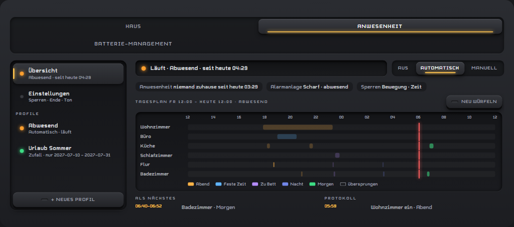

# Presence Simulation

House-wide presence simulation for Home Assistant. While nobody is home, lights are switched room by room following a realistic daily plan (evening, going to bed, a short trip at night, morning routine) instead of a fixed timer.


*Presence tab in the [Room Panel card](https://github.com/SysriX/room_panel_ha_card): running profile, today's generated plan per room and the event log (UI in German)*

Integration domain: `presence_sim`  
Version: 1.2.0  
UI language of the built-in texts (plan entries, reasons, log): German

> Built for the author's own home. It works with any lights, but some optional features rely on helper entities from the author's motion-lighting setup (see [Optional helper entities](#optional-helper-entities)). Room ids and defaults may need adapting.

## Features

- **House-wide mode**: `off`, `auto` (starts when a profile's conditions are met) or `manual` (runs now, optionally ends when someone comes home).
- **Profiles** (up to 20): activation conditions (away for at least X minutes, alarm panel state, weekdays, date range, and/or logic), participating rooms and the shape of the daily plan.
- **Daily plan** from 12:00 to 12:00, built every day at noon and on every change, visible even while the simulation is not running:
  - *Evening*: anchor rooms stay on from sunset (± offset) or a fixed time until bedtime; visitor rooms are visited briefly (weighted, configurable gaps and parallel visits)
  - *Bed*: a route of rooms (e.g. hallway → bathroom → bedroom) in a time window
  - *Night*: with a configurable probability a short, dimmed route
  - *Morning*: a short route on selected weekdays, optionally only while it is still dark
  - Room modes: random, fixed time slots (± jitter) or auto (fixed slots if set, otherwise random)
- **Light settings** per profile: color temperature, color, brightness only or just on, with transition.
- **Only its own lights**: lamps that are already on are not touched; lamps switched off by someone are left alone. At the end the simulation's lamps are turned off (or kept on, configurable).
- **Locks** for the author's other light integrations: while the simulation runs, `binary_sensor.haus_sys_presence_sim_active` exposes `lock_motion`, `lock_schedule` and `lock_lux`, which [Light Schedule](https://github.com/SysriX/light_schedule_ha_integration) and [Light Lux Control](https://github.com/SysriX/light_lux_ha_integration) (and the motion lighting) respect.
- Every switching action fires the event `presence_sim_switched`.
- Settings for sound, TV light and doorbell are already stored but have no effect yet.

## Entities

| Entity | Description |
| --- | --- |
| `sensor.haus_sys_presence_sim` | `off` / `ready` / `active`; attributes: settings, profiles, rooms, plan, next entry, running lamps, log |
| `binary_sensor.haus_sys_presence_sim_active` | Simulation running; attributes `profile`, `lock_motion`, `lock_schedule`, `lock_lux` |
| `select.haus_sys_presence_sim_mode` | House-wide mode `off` / `auto` / `manual` |

## Services

| Service | Description |
| --- | --- |
| `presence_sim.set_mode` | Set the house-wide mode (`off`, `auto`, `manual`) |
| `presence_sim.start` | Start manually (optional `profile_id`) |
| `presence_sim.stop` | Stop a manually started simulation |
| `presence_sim.replan` | Re-roll today's plan |

A WebSocket API (`presence_sim/settings`, `save`, `delete`, `preview`, `replan`, `start`, `stop`) is used by the companion card.

## Requirements

- Home Assistant 2024.6 or newer
- The `sun` integration (for sunset-based evening start)
- Recommended: the companion card for editing profiles (there is no config flow / options UI)

## Installation

### HACS (custom repository)

1. HACS → three-dot menu → **Custom repositories**
2. Repository `https://github.com/SysriX/presence_simulation_ha_integration`, category **Integration**
3. Install **Presence Simulation** and restart Home Assistant

### Manual

Copy `custom_components/presence_sim` into `<config>/custom_components/` and restart Home Assistant.

## Configuration

YAML only (no config flow). Add to `configuration.yaml` and restart:

```yaml
presence_sim:
  rooms: [wz, bu, ku, sz, fl, ke, ba, bz]   # optional, this is the default
```

`rooms` is a list of short room ids (slugs). The defaults are the author's German room abbreviations (living room, office, kitchen, bedroom, hallway, basement, balcony, bathroom); use your own ids if you like – they only need to match the room ids used by the companion card and the helper entities below. Profiles, settings and the plan are stored in `.storage/presence_sim`.

### Optional helper entities

These come from the author's motion-lighting YAML package (not published). You can create them yourself as helpers; the value of each `input_text` is an entity id.

| Helper | Purpose |
| --- | --- |
| `input_text.haus_light_motion_cfg_presence_sensor` | Presence source (`binary_sensor`, `person`, `group` or `zone.*` count). Needed for the profile condition "away". |
| `input_text.haus_light_motion_cfg_alarm_panel` | Alarm panel entity for the alarm condition |
| `group.<room>_light_motion_primary` or `input_text.<room>_light_motion_primary_cfg_members` | Default lamps of a room if the profile selects none |
| `input_select.<room>_light_motion_<primary\|secondary>_source` | Ownership flag shared with the motion lighting (option `simulation`) |

Without them, select lamps per room in the profile and set the presence condition to "ignore" (or provide the presence helper).

## Companion card

[room_panel_ha_card](https://github.com/SysriX/room_panel_ha_card) (`custom:raum-panel`) – settings → general → presence simulation.

## License

MIT – see [LICENSE](LICENSE).
